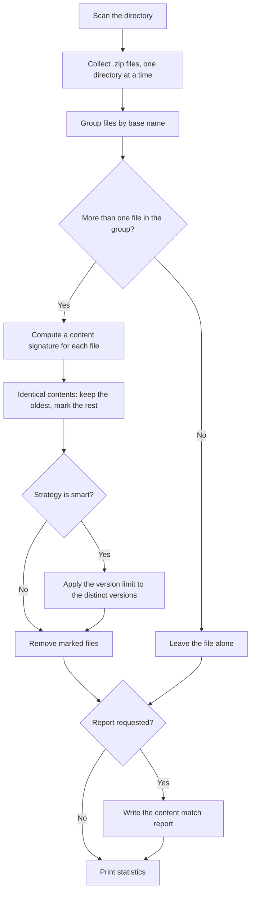
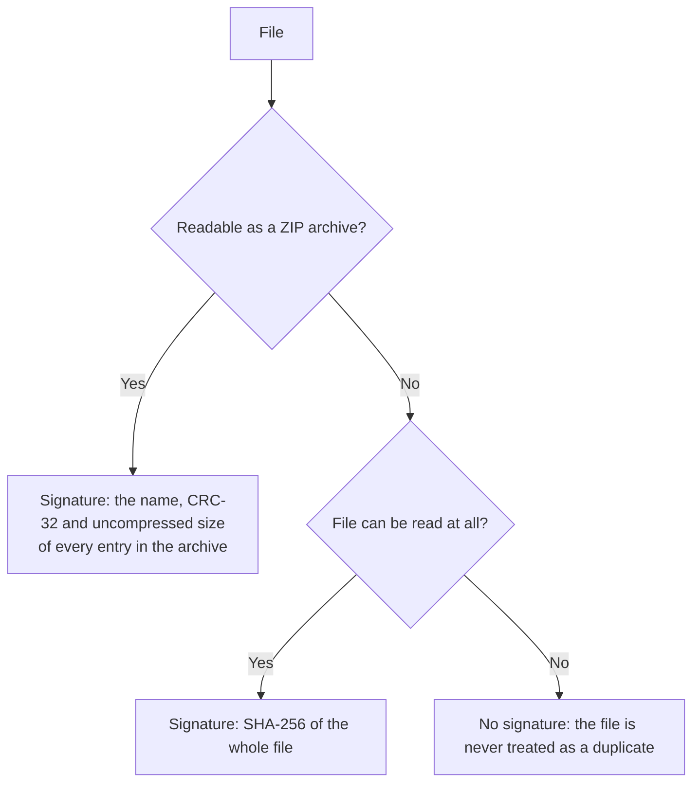
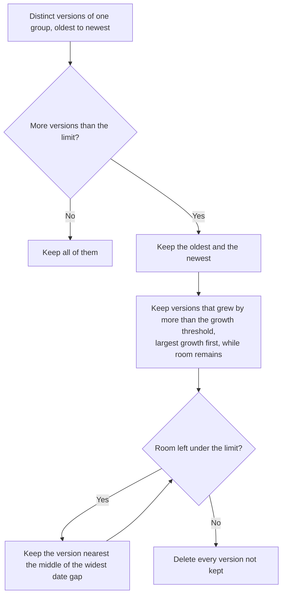
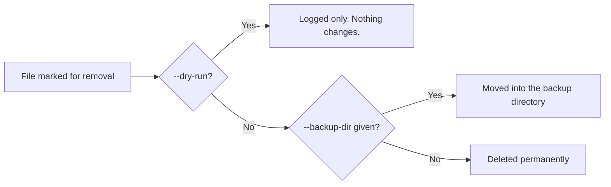
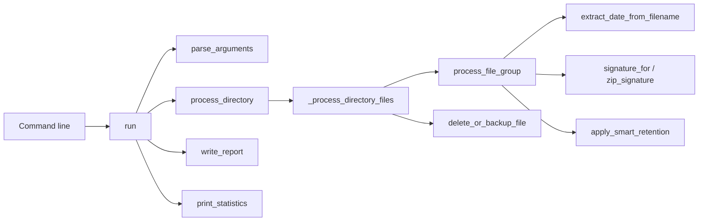
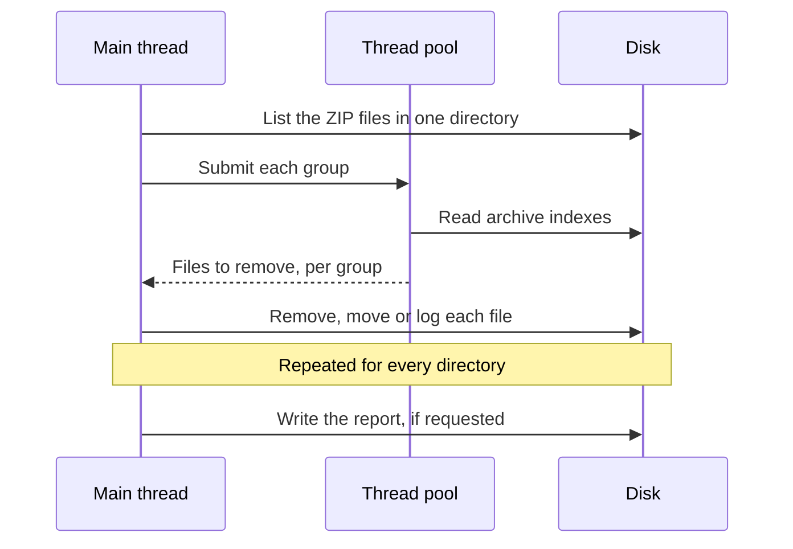

# ZIP Deduplication

Prunes series of timestamped ZIP snapshots. It removes snapshots whose contents are identical to an earlier one and, on request, limits each series to a fixed number of versions.

> **Run with `--dry-run` first.** Deletion is permanent unless you use `--backup-dir`.

## Table of contents

- [Why this exists](#why-this-exists)
- [What it does](#what-it-does)
- [Requirements and installation](#requirements-and-installation)
- [Quick start](#quick-start)
- [How a run works](#how-a-run-works)
- [How files are grouped](#how-files-are-grouped)
- [How content is compared](#how-content-is-compared)
- [Strategies](#strategies)
  - [Exact](#exact)
  - [Smart](#smart)
  - [Worked example](#worked-example)
- [What happens to a removed file](#what-happens-to-a-removed-file)
- [Content match report](#content-match-report)
- [Command-line reference](#command-line-reference)
- [Exit codes](#exit-codes)
- [Architecture](#architecture)
- [Limitations](#limitations)
- [Development](#development)
- [Changes from the first release](#changes-from-the-first-release)
- [License](#license)

## Why this exists

I mirror GitHub repositories to local storage as ZIP snapshots named `<repo>_<timestamp>.zip`. The mirroring tool skips repositories that have not changed, but a repository's metadata can change while its source stays the same. The result is a new snapshot with different bytes and the same contents.

This tool compares what is inside the archives, so those snapshots are recognized as duplicates. It can also thin a long history down to the versions worth keeping when storage is limited.

## What it does

- **Removes identical snapshots.** Within a series, snapshots with the same contents are reduced to the oldest one.
- **Limits versions per series (optional).** With the `smart` strategy, a series with more distinct versions than the limit is cut to exactly the limit.
- **Reports matches it will not act on.** Archives with identical contents under different names or in different directories are listed in a report and never deleted.
- **Offers a preview and a safety net.** `--dry-run` changes nothing. `--backup-dir` moves files instead of deleting them.

## Requirements and installation

- Python 3.10 or later.
- No third-party packages. The tool uses only the standard library.

```bash
git clone https://github.com/StephenGenusa/zip-deduplication.git
cd zip-deduplication
```

It is developed and tested on Linux. It makes no platform-specific calls.

## Quick start

Preview the removal of identical snapshots under a directory tree:

```bash
python3 zipdeduplication.py /path/to/snapshots --recursive --dry-run
```

Remove identical snapshots, moving them to a backup directory instead of deleting them:

```bash
python3 zipdeduplication.py /path/to/snapshots --recursive --backup-dir /path/to/backup
```

Also limit every series to 8 distinct versions:

```bash
python3 zipdeduplication.py /path/to/snapshots --recursive --strategy smart --max-versions 8
```

Write a report of identical archives the run does not remove:

```bash
python3 zipdeduplication.py /path/to/snapshots --recursive --dry-run --report matches.tsv
```

## How a run works



With `--recursive`, every subdirectory is processed in turn. Files are only ever compared for removal with other files in the same directory.

## How files are grouped

A group, or series, is the set of ZIP files in one directory that share a base name. The base name is the file name with its extension and timestamp suffix removed.

| File name | Base name |
|---|---|
| `widget_2024-10-09 05-59-01.zip` | `widget` |
| `widget_2024-10-10 06-00-12.zip` | `widget` |
| `widget_2024-10-09.zip` | `widget` |
| `gadget_10-09-2024.zip` | `gadget` |
| `tool-1.0.0.zip` | `tool-1.0.0` |

Timestamp suffixes recognized for grouping, each introduced by an underscore:

| Suffix | Example |
|---|---|
| `_YYYY-MM-DD HH-MM-SS` | `_2024-10-09 05-59-01` |
| `_YYYY-MM-DD` or `_YYYY_MM_DD` | `_2024-10-09` |
| `_MM-DD-YYYY` or `_MM_DD_YYYY` | `_10-09-2024` |

The order of files within a group comes from the timestamp in the name, including the time of day. A file whose name holds no date is ordered by its modification time. A trailing version number such as `1.0.0` is not treated as a date.

> These patterns match the names my own download tooling produces (`repo_name_YYYY-MM-DD HH-MM-SS.zip`). If your snapshots are named differently, adjust `get_base_filename` and `extract_date_from_filename` to suit.

## How content is compared

Each file gets a content signature. Two files are identical when their signatures are equal.



- **Readable archives** are compared by their entry lists, read from the archive's index. Two archives with the same entries match even when their bytes differ through compression level, entry order or internal timestamps. Entries that share a name are all compared.
- **Files that are not readable archives** match only an exact byte-for-byte copy.
- **Each file is read once per run.** Nothing is cached between runs.

## Strategies

### Exact

The default. Within each group, files with identical contents are reduced to the oldest one. Files with different contents are never removed.

### Smart

Smart does everything exact does, then applies a version limit to what remains.

The limit, `--max-versions`, counts distinct versions. Identical copies have already been removed and do not count toward it.



The rules in order of priority:

1. **Within the limit, nothing is deleted.** A group with as many distinct versions as the limit, or fewer, is left alone.
2. **The oldest and the newest are always kept.**
3. **Versions that grew are kept next.** A version qualifies when its size is more than `--growth-threshold` percent above the smallest size seen since the last qualifying version. If more qualify than there is room for, the largest growths are kept. A version that shrank gets no priority.
4. **Remaining room is filled by date.** The version nearest the middle of the widest gap between two kept versions is added, and this repeats until the limit is reached.

A group over the limit always ends with exactly `--max-versions` versions.

### Worked example

Ten distinct versions, ten days apart, with `--max-versions 4` and the default 5% growth threshold. The only size change is at `f6`.

| Version | Day | Size | Kept | Reason |
|---|---|---|---|---|
| `f0` | 0 | 1000 | Yes | Oldest |
| `f1` | 10 | 1000 | No | |
| `f2` | 20 | 1000 | No | |
| `f3` | 30 | 1000 | Yes | Middle of the widest gap (`f0` to `f6`) |
| `f4` | 40 | 1000 | No | |
| `f5` | 50 | 1000 | No | |
| `f6` | 60 | 1500 | Yes | Grew 50% |
| `f7` | 70 | 1500 | No | |
| `f8` | 80 | 1500 | No | |
| `f9` | 90 | 1500 | Yes | Newest |

## What happens to a removed file



- **Dry run.** Nothing is deleted, moved or created. The statistics show what would be removed.
- **Backup.** The file is moved to the backup directory under the same relative path it had in the scanned directory. A file already in the backup is never overwritten; the incoming file gets a numbered name such as `name (1).zip`. The backup directory is never scanned, so it can sit inside the scanned tree.
- **Delete.** The file is removed.

## Content match report

`--report [PATH]` writes a tab-separated file listing every set of two or more archives with identical contents that the run did not remove. These are archives with different base names or in different directories.

- Nothing listed in the report is deleted.
- The file is overwritten on every run.
- Without a path, it is written to `zip_content_matches.tsv` in the current directory.
- With a report, every ZIP file is read, including files that have no sibling in their group.

| Column | Meaning |
|---|---|
| `set` | Number of the set. Files with the same number have identical contents. |
| `files_in_set` | How many files are in the set. |
| `size_bytes` | Size of this file. |
| `path` | Path of this file. |

Sets are ordered by the space that would be freed by keeping only one copy, largest first.

## Command-line reference

```
python3 zipdeduplication.py DIRECTORY [options]
```

| Option | Default | Description |
|---|---|---|
| `DIRECTORY` | required | Directory to scan for ZIP files. |
| `-r`, `--recursive` | off | Also scan every subdirectory. |
| `-t`, `--threads N` | half the CPU cores | Number of groups examined in parallel. Must be at least 1. |
| `-s`, `--strategy {exact,smart}` | `exact` | `exact` removes identical snapshots. `smart` also applies the version limit. |
| `-m`, `--max-versions N` | `5` | Smart only. Most distinct versions kept per group. Must be at least 2. |
| `-g`, `--growth-threshold PCT` | `5.0` | Smart only. Growth, in percent, that gives a version priority when a group is cut down. |
| `-n`, `-d`, `--dry-run` | off | Show what would be removed without changing anything. |
| `-b`, `--backup-dir DIR` | none | Move removed files here instead of deleting them. |
| `--report [PATH]` | none | Write the content match report. |
| `-v`, `--verbose` | off | Show debug output. |
| `-q`, `--quiet` | off | Show only warnings, errors and the final statistics. |

## Exit codes

| Code | Meaning |
|---|---|
| `0` | The run completed without errors. |
| `1` | The run completed, but at least one group or file could not be processed. |
| `2` | Invalid options, or the directory does not exist. |
| `130` | Interrupted with Ctrl+C. No further files were removed after the interrupt. |

## Architecture

The tool is a single module, `zipdeduplication.py`, built around one class, `ZipDeduplicator`.



| Part | Responsibility |
|---|---|
| `run` | Orchestrates a run and returns the exit code. |
| `process_directory` | Walks the tree and hands each directory's ZIP files on. Skips the backup directory. |
| `_process_directory_files` | Groups files by base name and submits each group to the thread pool. |
| `process_file_group` | Orders a group, finds identical contents and returns the files to remove. |
| `zip_signature` | Computes a file's content signature. |
| `apply_smart_retention` | Chooses which distinct versions to delete under the version limit. |
| `delete_or_backup_file` | Logs, moves or deletes one file and updates the statistics. |
| `write_report` | Writes the content match report. |

Groups are examined in parallel, but only the main thread removes files:



Worker threads only read. Every deletion, move and statistics update happens on the main thread, one file at a time.

## Limitations

- **Removal is per directory and per base name.** Identical archives elsewhere are reported, not removed.
- **Timestamps with an underscore before the time do not group.** A name such as `repo_2023-01-30_14-30-45.zip` is dated correctly but is not grouped with its siblings. Use a space before the time, as in `repo_2023-01-30 14-30-45.zip`.
- **Archive comparison trusts the archive index.** It compares each entry's CRC-32 and size, not the stored data, so damage inside an archive whose index is intact is not detected.
- **Size stands in for significance.** Smart retention sees how much a version's size changed, not what changed inside it. A large rewrite that leaves the size unchanged looks like no change.
- **A group over the limit is always cut to the limit,** even when its versions are close together in time.
- **Symbolic links are not handled specially.**

## Development

Tests use pytest and create all their files in temporary directories.

```bash
uv run pytest
```

| Path | Contents |
|---|---|
| `zipdeduplication.py` | The tool. |
| `tests/test_zipdeduplication.py` | Tests. |
| `pyproject.toml`, `uv.lock` | Project metadata and the locked development dependency (pytest). |

## Changes from the first release

- **Smart retention has a new rule.** A group over `--max-versions` is cut to exactly that many versions: the oldest and newest, then versions that grew past `--growth-threshold`, then versions spread across the widest gaps in time. See [Smart](#smart).
- **`-k`, `--keep-interval` is removed.** Spacing between kept versions now comes from the widest-gap rule above.
- **Content comparison is stricter.** Every entry's name, CRC-32 and size must match. Files that are not readable ZIP archives are compared by SHA-256.
- **Time of day is used for ordering,** so several snapshots from one day sort correctly.
- **New `--report` option** writes the [content match report](#content-match-report).
- **`-d` is accepted for `--dry-run`** as well as the original `-n`.
- **Exit codes are defined.** See [Exit codes](#exit-codes).

## License

MIT © [Stephen Genusa](https://github.com/StephenGenusa). See [LICENSE](LICENSE).
